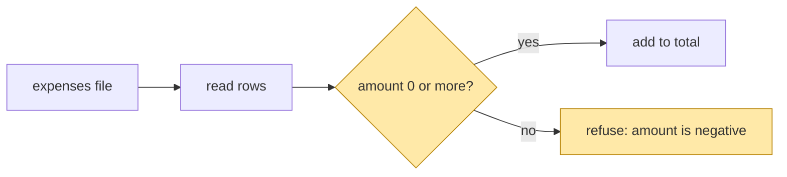

# Explaining each step in plain words

The reader is the developer following the work. They know what the project is
for, but not necessarily test-driven development or the code. Each checkpoint
tells them what the program can now do, in words they would use themselves.

## The rules

- After the progress line, start with **In plain words**: two or three
  sentences. Say what the program can now do that it could not do before, with
  one concrete example from the example map: a real input and the exact
  result. For a refactor, say that the behaviour did not change and what got
  easier.
- Use the terms in `docs/GLOSSARY.md`. A term that is not there gets one plain
  sentence and a new row (section 2a of the skill).
- Describe only what the diff shows. Planned work is not done work, and a
  refactoring the diff does not contain is not reported.
- Leave out tool and framework names unless the reader needs one to act.
- Then the technical part, as before: at most about 8 lines.

## When to draw

- Draw when a step changes structure or flow: a new module, one part now
  calling another, data taking a new path, a new error path.
- No diagram for a Red step or a rename.
- Use Mermaid. Show only the changed part and its direct neighbours, at most
  about ten nodes, with the new part in the `new` class. Label the boxes with
  words, so the diagram still reads where it shows as text (a terminal); it
  is drawn in VS Code chat, the Markdown preview, GitHub and GitLab.

## The walkthrough file

- Append each checkpoint's plain part, and its diagram, to
  `.walkthrough/<branch>.md`, with every `/` in the branch name replaced by
  `-`. Git ignores `.walkthrough/`, so it is never committed.
- Head each entry with the progress line, for example
  `### Step 3/8 · Green · a negative amount is refused`.
- When the user asks for the pull request, write its description from the
  walkthrough.
- When the user is not present, the report carries the plain explanations in
  commit order (`references/pace.md`).

## Example project

The examples follow one subtask in a small expense report that reads a CSV
file of expenses and adds up the amounts. The subtask: refuse expenses that
make no sense.

## Test list

> **In plain words:** Next, the program learns to refuse expenses that make no
> sense. I wrote four checks, all switched off for now: a negative amount, a
> missing amount, a date that is not a date, and a normal row that must still
> be accepted.

## Red

> **In plain words:** I switched on the first check: a row with the amount −5
> must be refused with the reason "amount is negative". It fails, which is
> what we want: today the program adds −5 to the total.

## Green

> **In plain words:** The program now refuses a row with the amount −5 and
> reports "amount is negative" with the row's line number; the total leaves it
> out. Rows with normal amounts are added as before.



The whole checkpoint, plain part first:

```text
Step 3/8 · cycle 1 of 4 · next: a missing amount
In plain words: The program now refuses a row with the amount −5 and reports
"amount is negative" with its line number; the total leaves it out.
Green: test_negative_amount_is_refused passes. Change: validate_row returns a
RejectedRow for amount < 0. Predicted: passes, rest green. Result: Correct.
```

## Refactor

> **In plain words:** Nothing the program does has changed. The refusal
> messages were spread over three functions; they are now in one table, so a
> new reason is one new line.

When the review finds nothing: "Nothing the program does has changed, and
nothing needed tidying."
